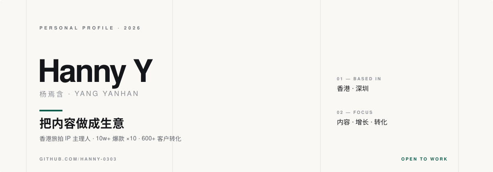

  

  
  
  
  

<strong>简体中文</strong> · <a href="README_EN.md">English</a>

---

## 01 — 关于我

香港大学社会学硕士（2026 年 12 月毕业），香港岭南大学经济学学士，荷兰乌得勒支大学全额奖学金交换。读了四年「人为什么这样选择」，现在在做一件更具体的事：**把一个旅拍服务从 0 做到能赚钱。**

2025 年 9 月起，我独立操盘一个香港旅拍 IP——内容策略、社媒矩阵、达人合作、私域转化，全链路自己跑。累计做出 10+ 条 10w+ 爆款（最高 35w+），全网浏览过百万，转化 600+ 高粘性客户，复购和转介绍一直在发生。

| 内容与增长 | 研究与洞察 |
| --- | --- |
| 海内外社媒矩阵（小红书 / 抖音 / TikTok / Instagram）、爆款选题、脚本与剪辑、KOL 共创与商务洽谈。 | 定量实验设计、竞品调研、结构化洞察输出，把模糊的问题拆成可验证的假设。 |

我不太相信「灵感」这套说法。选题可以拆结构，脚本可以复用骨架，投放可以算漏斗——把每次发布当成一次实验，数据回来就改。

## 02 — 精选项目

<table>
  <tr>
    <td>
      <h3>香港旅拍 IP 服务项目</h3>
      
<b>创始人 / 主理人 · 2025.09 – 2026.09</b>

      
针对「不知道拍什么、不知道怎么拍、不知道去哪拍」三个痛点，把旅拍拆成可复制的内容产品：选题库、拍摄脚本、路线推荐。抖音 / 小红书双平台持续更新，产出 10+ 条 10w+ 爆款（最高 35w+），全网浏览超百万；自建私域流量池，转化 600+ 高粘性客户，靠复购与转介绍自然增长。

    </td>
  </tr>
  <tr>
    <td>
      <h3>美联集团（香港）· 市场调研与策略分析实习</h3>
      
<b>实习生 · 2024.06 – 2024.08</b>

      
调研香港 500+ 家机构，收集行业动态与竞品信息，输出结构化洞察报告并构建用户画像；连续 3 个月每周产出 3 篇原创分析文章（累计 36 篇），支撑前端业务策略。

    </td>
  </tr>
  <tr>
    <td>
      <h3>「AI 部署中如何不扼杀创造力」科研项目</h3>
      
<b>核心研究助理 · 2023.09 – 2025.05</b>

      
独立设计并落地 50+ 人参与的定量实验，建立标准 SOP 与数据质检流程；累计产出 80+ 份结构化分析简报，数据零差错、100% 可追溯，输出的用户洞察直接用于业务策略。

    </td>
  </tr>
</table>

## 03 — 技能

| 层级 | 我在用的东西 |
| --- | --- |
| 内容生产 | 选题策划 · 脚本撰写 · 视频剪辑 · 图文排版 · 修图 |
| 平台 | 小红书 · 抖音 · TikTok · Instagram Reels · YouTube |
| 工具 | Canva · Excel · PowerPoint · ChatGPT · DeepSeek |
| 分析 | 曝光 / 点击 / 转化漏斗复盘 · 竞品调研 · 定量实验设计 |

## 04 — 教育

- **香港大学** — 社会学硕士（MSc in Sociology）· 2025.09 – 2026.12
- **香港岭南大学** — 社会科学（荣誉）学士 · 主修经济学，副修商学 · 2021.09 – 2025.08
  - cGPA 3.44 / 4.0 · 连续 3 次入选院长荣誉名单（Dean's List）
- **乌得勒支大学（荷兰）** — 交换生项目 · 2024.09 – 2024.12 · 获最高额度奖学金

## 05 — 当前

- **在找**：运营方向（产品运营 / 内容运营 / 社交媒体运营）或销售岗
- **时间**：2026 年 12 月毕业，可 11 月到岗
- **在做**：把旅拍项目的复盘整理成一套可复用的内容方法论
- **在学**：AI 工具在内容生产链路上的实际落地

## 06 — 联系

欢迎聊运营、内容增长、商业化相关的一切——实习、全职、合作都行。

📮 [u3665970@connect.hku.hk](mailto:u3665970@connect.hku.hk) · 📍 香港 / 深圳

---

头图为手写 SVG，零外部依赖；除上方访问计数外无任何统计。
