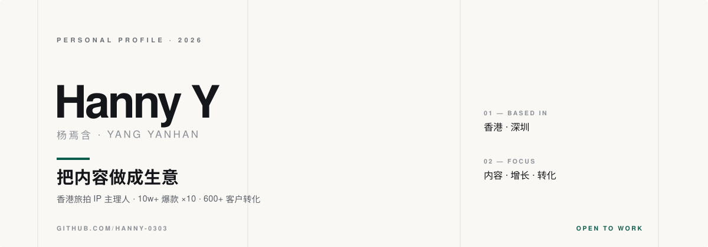

  

  
  
  
  

<strong>English</strong> · <a href="README.md">简体中文</a>

---

## 01 — About

MSc in Sociology at The University of Hong Kong (graduating Dec 2026), BSc in Economics from Lingnan University, exchange semester at Utrecht University on a full scholarship. I spent four years studying *why people choose what they choose*; now I do something more concrete — **I build a travel-photography service from zero into a business.**

Since Sept 2025 I have run a Hong Kong travel-photography IP end to end: content strategy, social matrix, creator partnerships, private-domain conversion. 10+ posts past the 100k-view mark (peak 350k+), over a million total views, 600+ high-intent customers converted, with repeat purchases and referrals continuing organically.

| Content & Growth | Research & Insight |
| --- | --- |
| Social matrix across Xiaohongshu, Douyin, TikTok and Instagram; viral topic design, scripting, editing, KOL co-creation and deal-making. | Quantitative experiment design, competitive research and structured insight output — turning fuzzy questions into testable hypotheses. |

I don't buy the "inspiration" story. Topics can be deconstructed, scripts can reuse skeletons, distribution can be measured as a funnel. Treat every post as an experiment, and let the data decide the next move.

## 02 — Selected Work

<table>
  <tr>
    <td>
      <h3>Hong Kong Travel-Photography IP</h3>
      
<b>Founder &amp; Lead · 2025.09 – 2026.09</b>

      
Built around three real pain points — people don't know what to shoot, how to shoot it, or where to go. Turned travel photography into a repeatable content product: a topic library, shooting scripts and route recommendations. Sustained publishing on Douyin and Xiaohongshu produced 10+ posts above 100k views (peak 350k+) and over a million total views; a self-built private-domain funnel converted 600+ high-intent customers, with growth driven by repurchase and referral.

    </td>
  </tr>
  <tr>
    <td>
      <h3>Midland Holdings (HK) · Market Research &amp; Strategy Intern</h3>
      
<b>Intern · 2024.06 – 2024.08</b>

      
Researched 500+ institutions across Hong Kong, mapped competitors and built user personas into structured insight reports; wrote 3 original analysis articles per week for 3 consecutive months (36 in total) to support front-line business strategy.

    </td>
  </tr>
  <tr>
    <td>
      <h3>"How Not to Kill Creativity in AI Deployment" (Research Project)</h3>
      
<b>Core Research Assistant · 2023.09 – 2025.05</b>

      
Designed and ran a quantitative experiment with 50+ participants, establishing a standard SOP and data-quality process; delivered 80+ structured analysis briefs with zero data errors and 100% traceability, feeding user insight directly into business decisions.

    </td>
  </tr>
</table>

## 03 — Stack

| Layer | What I Work With |
| --- | --- |
| Content | Topic strategy · Scriptwriting · Video editing · Layout · Retouching |
| Platforms | Xiaohongshu · Douyin · TikTok · Instagram Reels · YouTube |
| Tools | Canva · Excel · PowerPoint · ChatGPT · DeepSeek |
| Analytics | Impression / click / conversion funnel review · Competitive research · Experiment design |

## 04 — Education

- **The University of Hong Kong** — MSc in Sociology · 2025.09 – 2026.12
- **Lingnan University, Hong Kong** — Bachelor of Social Science (Hons), Major in Economics, Minor in Business · 2021.09 – 2025.08
  - cGPA 3.44 / 4.0 · Dean's List, three consecutive years
- **Utrecht University (Netherlands)** — Exchange programme · 2024.09 – 2024.12 · Full-tuition scholarship

## 05 — Currently

- **Looking for**: operations roles (product / content / social media) or sales
- **Timeline**: graduating Dec 2026, available from November
- **Building**: a reusable content playbook distilled from the travel-photography project
- **Learning**: where AI tools actually fit in the content production chain

## 06 — Contact

Open to conversations about operations, content growth and monetisation — internships, full-time roles and collaborations alike.

📮 [u3665970@connect.hku.hk](mailto:u3665970@connect.hku.hk) · 📍 Hong Kong / Shenzhen

---

Hero banner is hand-written SVG with no external dependencies; no tracking beyond the view counter above.
